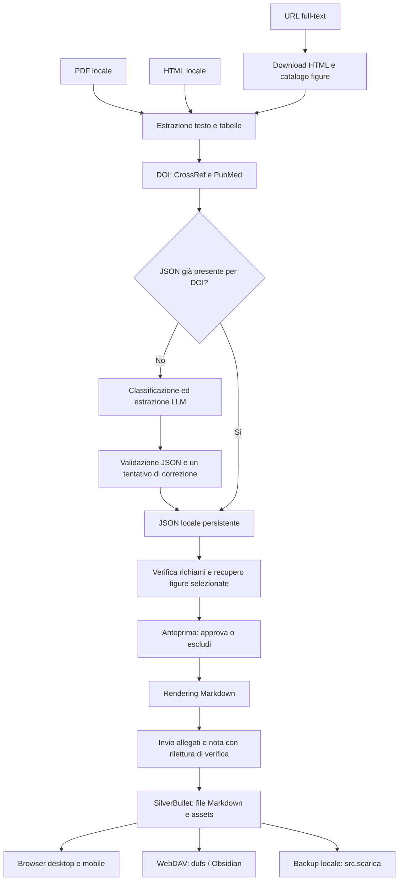

# Paper Vault

Pipeline per trasformare articoli di letteratura medica in note operative in italiano, consultabili in SilverBullet o in un altro lettore Markdown. Accetta **PDF, HTML locali e URL di pagine con il full-text**. Le figure vengono incluse solo quando sono richiamate nei passaggi della fonte utilizzati nella sintesi finale.

Il progetto comprende la pipeline Python, prompt e schema JSON, template Markdown, test e configurazioni di esempio per il vault Docker. La pipeline gira attualmente sul Mac; sulla VPS girano SilverBullet, il servizio WebDAV e il proxy HTTPS. Non è necessario spostare l'elaborazione sul server per usare il vault da mobile.

**Documentazione di riferimento:** questo README descrive il comportamento attuale. [ISTRUZIONI.md](ISTRUZIONI.md) contiene appunti operativi per l'installazione personale; [HANDOVER.md](HANDOVER.md) conserva anche decisioni e fasi storiche, non tutte ancora attuali.

## Avvio rapido

Requisiti: Python **3.11 o successivo**, accesso a uno dei fornitori LLM supportati, connessione per i metadati bibliografici e le fonti web. Per PDF scansionati serve anche l'eseguibile `ocrmypdf`; per PDF con testo e articoli web non serve.

```bash
git clone https://github.com/internalempire/paper-vault.git
cd paper-vault
python3 -m venv .venv
source .venv/bin/activate
python -m pip install -r requirements.txt
cp config.example.toml config.toml
cp .env.example .env
```

Il repository è privato: il clone richiede un account GitHub autorizzato. Compilare `.env` con la chiave del fornitore scelto e, se si vuole pubblicare, con le credenziali del vault. Adattare `config.toml`; i percorsi relativi in quel file sono risolti rispetto alla radice del progetto. I comandi seguenti vanno eseguiti dalla radice del progetto con l'ambiente virtuale attivo.

```bash
# Controllo senza chiamate al modello né scrittura delle note
python -m src.ingest "/percorso/articolo.pdf" --dry-run
python -m src.ingest "https://editore.example/articolo/full" --dry-run

# Elaborazione e salvataggio locale
python -m src.ingest "/percorso/articolo.pdf"
python -m src.ingest "https://editore.example/articolo/full"

# Elaborazione e tentativo di pubblicazione sul vault
python -m src.ingest "https://editore.example/articolo/full" --pubblica
```

Se ci sono figure da verificare, il testo e il JSON vengono salvati ma la pubblicazione resta bloccata fino all'approvazione o all'esclusione di tutte le figure selezionate. L'anteprima indicata nel riepilogo si apre nel browser. La procedura completa è nella sezione **Figure**.

## Architettura



| Componente | Responsabilità |
|---|---|
| `src/ingest.py` | Configurazione, orchestrazione, riuso del JSON per DOI, salvataggio e pubblicazione |
| `src/extract.py` | PDF a colonne, tabelle, OCR, pagine stampate, HTML locale e ingresso da URL |
| `src/web_article.py` | Download full-text, selezione del corpo HTML, DOI dichiarato, catalogo figure e download originali |
| `src/metadata.py` | DOI, metadati CrossRef/PubMed, citazione, nome del file |
| `src/llm.py`, `src/llm_openai.py`, `src/llm_anthropic.py` | Prompt, chiamate al fornitore, validazione/correzione, uso dei token |
| `src/schema.py`, `schema/nota.schema.json` | Contratto e validazione dell'output del modello |
| `src/figure.py` | Verifica dei richiami, ritagli PDF, anteprima, approvazione e inserimento delle figure |
| `src/render.py`, `templates/` | Rendering deterministico del JSON in Markdown |
| `src/pubblica.py` | Autenticazione SilverBullet, upload binari, fusione delle note, verifica |
| `src/tags.py`, `tags.md` | Vocabolario controllato e gestione dei tag proposti |
| `src/indice.py` | Indice statico generato dai JSON locali |
| `src/scarica.py` | Copia di sicurezza delle note remote e degli allegati |
| `deploy/` | Esempi Docker Compose e Caddy senza segreti |

Non ci sono ancora watcher, interfaccia di caricamento, coda di elaborazione, database SQLite o schedulazione automatica. L'ingresso è un comando esplicito. La pipeline non archivia né sposta il PDF originale.

## Pipeline e regole di contenuto

1. **Acquisizione.** Dal PDF vengono estratti testo in ordine di lettura, tabelle e intestazioni. Quando manca lo strato testuale viene tentato l'OCR. Il sistema ricostruisce le pagine stampate; se non è possibile, i riferimenti devono usare le sezioni. Dal web viene scaricato l'HTML e isolato il contenuto dell'articolo, conservando intestazioni, elenchi e tabelle.
2. **Bibliografia.** Il DOI del PDF viene cercato nella prima pagina. Per un URL viene letto dai metadati HTML dichiarati dall'editore, senza scegliere per errore un DOI della bibliografia. CrossRef e, come ripiego, PubMed forniscono i metadati: il modello non li inventa. Campi mancanti o titoli discordanti vengono segnalati.
3. **Riuso.** Se esiste un JSON con lo stesso DOI, la nota viene rigenerata senza chiamare il modello. `--forza` richiede una nuova elaborazione a pagamento. Senza DOI questa deduplicazione non è disponibile.
4. **LLM.** Prima viene classificato l'articolo, poi viene estratto il contenuto secondo il prompt v4. PDF e web usano lo stesso prompt, schema e criterio di inclusione. Il documento è materiale da analizzare: le eventuali istruzioni contenute nella fonte non sostituiscono quelle della pipeline.
5. **Validazione.** Il JSON deve rispettare lo schema; in caso di errore viene tentata una correzione del modello. Un errore persistente ferma l'elaborazione. Le note supportano narrative review e linee guida secondo le regole del prompt; gli altri tipi vengono gestiti secondo la classificazione prevista dal prompt.
6. **Persistenza.** Il JSON viene salvato prima del recupero delle figure, per non perdere l'estrazione già pagata in caso di download fallito. Per il web contiene anche il testo estratto, il catalogo immagini e la provenienza della pagina.
7. **Figure e rendering.** Python verifica i richiami selezionati; recupera gli originali web o propone ritagli PDF. Dopo la revisione, il renderer inserisce le immagini nella sezione pertinente e produce il Markdown.
8. **Pubblicazione.** Gli allegati sono inviati e riletti prima della nota. Il Markdown locale viene cancellato soltanto dopo aver verificato il contenuto remoto. JSON, anteprime e immagini locali restano disponibili.

Le note devono essere dense e operative, in italiano, fedeli alla fonte, con cifre, dosaggi e ambiguità tracciabili. La validazione dello schema non certifica la correttezza clinica: il controllo della nota e dei dati numerici sulla fonte resta parte del lavoro. I riferimenti sono conservati nel JSON; il renderer attuale nasconde i richiami puntuali nel Markdown (`MOSTRA_RIFERIMENTI` in `src/render.py`).

### Ingresso da pagina web

Passare **l'URL del full-text**, non quello della ricerca, dell'abstract o del PDF remoto. L'URL va racchiuso tra virgolette, soprattutto se contiene `&`.

```bash
python -m src.extract "https://editore.example/articolo/full" --report
python -m src.extract "https://editore.example/articolo/full" --text --out /tmp/articolo-estratto.txt
python -m src.ingest "https://editore.example/articolo/full" --dry-run
python -m src.ingest "https://editore.example/articolo/full"
```

Il parser supporta strutture HTML comuni (`article`, `main`, contenitori del corpo dell'articolo e figure con didascalie), comprese quelle Frontiers verificate sul corpus del progetto. Seleziona il corpo e scarta navigazione, script e componenti estranee. Verifica che esista prosa sufficiente sotto sezioni diverse dall'abstract o dalla bibliografia. Questo controllo è euristico: **non garantisce che ogni editore abbia fornito tutto il testo**. Controllare l'estratto prima di una chiamata a pagamento, soprattutto su siti nuovi.

Sono supportate pagine HTTP(S) pubblicamente accessibili, con testo presente nell'HTML. Non vengono eseguiti JavaScript né usati cookie personali. Paywall, challenge anti-bot, pagine di login, abstract isolati o layout non riconosciuti richiedono il PDF oppure un HTML locale completo. Un URL che restituisce un PDF viene rifiutato: scaricare il PDF e passarlo come file locale.

I redirect vengono controllati, la verifica TLS resta attiva e non vengono usate le credenziali del vault per scaricare le fonti. Risorse su indirizzi privati o locali sono escluse. Limiti attuali: HTML 15 MiB, singola immagine 25 MiB, 50 megapixel; figure animate e SVG non sono supportati. Gli HTML locali conservano il precedente percorso di estrazione testuale; per il recupero automatico delle immagini usare l'URL originale.

### Figure

**Criterio:** inserire solo le figure citate nei passaggi originali da cui deriva il riassunto operativo. Non basta che una figura sia attinente al tema, e non è necessario che il numero della figura sia ripetuto nella parafrasi italiana.

Il modello restituisce `figure_richieste` con numero, citazione letterale della fonte e titolo della sezione della nota. Python controlla che citazione e numero siano presenti e che la sezione di destinazione sia univoca. Nel web la citazione viene verificata sul corpo, escludendo didascalie e bibliografia riconosciuta. La pertinenza semantica alla sintesi resta affidata alla selezione del modello e alla revisione umana.

- **PDF:** viene proposta un'immagine PNG renderizzando l'area della figura, per conservare vettori, scritte e pannelli. La geometria può richiedere correzione manuale.
- **Web:** vengono conservati i byte originali PNG, JPEG o WebP, scegliendo, quando dichiarata, una risorsa ad alta risoluzione. Sono riconosciuti link diretti, immagini lazy e `srcset`; didascalia e URL restano nel JSON. Non vengono generate o ridisegnate immagini.
- **Ambiguità:** numeri duplicati con risorse diverse, didascalie mancanti, più immagini separate per la stessa figura o risorse non scaricabili vengono segnalati. Non si sceglie arbitrariamente un pannello.

Ogni figura passa per `non_disponibile`, `da_verificare`, `approvata` oppure `esclusa`. Finché esistono figure non disponibili o da verificare, la nota non viene pubblicata.

```bash
# Mostra il percorso dell'anteprima già generata; aprirla nel browser
python -m src.figure "/cartella/note/.json/NOME.json"

# Dopo aver controllato completezza, didascalia e pertinenza
python -m src.figure "/cartella/note/.json/NOME.json" --approva 1 2

# Escludi una figura che non vuoi inserire, anche se non recuperabile
python -m src.figure "/cartella/note/.json/NOME.json" --escludi 3

# Ripeti soltanto i download web falliti, dalla fonte salvata nel JSON
python -m src.figure "/cartella/note/.json/NOME.json" --riprova

# Solo PDF: correggi il ritaglio, poi approva
# Pagina fisica del PDF da 1; coordinate x0 y0 x1 y1 in punti PDF
python -m src.figure "/cartella/note/.json/NOME.json" --ritaglio 1 4 50 100 550 600
python -m src.figure "/cartella/note/.json/NOME.json" --approva 1

# Pubblica il Markdown rigenerato dopo la revisione
python -m src.pubblica "/cartella/note/NOME.md"
```

Se si usa una cartella diversa da `config.toml`, passare anche `--note /cartella/note` a `src.figure`. `--riprova` non chiama il modello e non modifica le figure già approvate o escluse. Un URL firmato scaduto o una pagina cambiata può richiedere un nuovo ingresso: il recupero conservativo usa il catalogo salvato, non associa nuove immagini a un testo diverso.

Le immagini vengono salvate in `assets/<nome-nota>/figura-<numero>-<hash>.<estensione>`. Nel Markdown sono normali collegamenti:

```markdown

```

Markdown supporta nativamente questo riferimento a un file immagine: non serve incorporare i byte nel testo né un plugin dedicato. SilverBullet serve gli allegati della stessa cartella del vault. Portando una nota in un altro lettore, conservare anche la cartella `assets/` e i percorsi relativi. Le immagini remote non restano dipendenti dal sito dell'editore dopo il download.

## Configurazione

`config.toml` è locale e non viene versionato. L'esempio completo è [config.example.toml](config.example.toml).

| Sezione | Campi principali |
|---|---|
| `percorsi` | `note`, `json`: cartelle di lavoro; consigliato tenerle fuori dal codice |
| `modelli` | `fornitore` (`openai` o `anthropic`), `estrazione`, `classificazione` |
| `estrazione` | `prompt`, `ocr`, `tabelle`, `soglia_token_avviso` |
| `metadati` | `crossref_mailto`, `timeout_secondi` per CrossRef/PubMed |

Con modelli vuoti vengono usati i default definiti negli adattatori. Scegliere modelli disponibili per il proprio account. La soglia token è un avviso, non un limite che tronca il documento: il frazionamento automatico non è implementato. Il timeout bibliografico non modifica quello dei download web, definito in `src/web_article.py`.

`.env` contiene solo la chiave del fornitore necessario e le eventuali credenziali del vault:

```dotenv
OPENAI_API_KEY=...
# oppure ANTHROPIC_API_KEY=...
VAULT_URL=https://vault.example.org
VAULT_UTENTE=utente
VAULT_PASSWORD=...
```

Le variabili già esportate nell'ambiente prevalgono sul file. L'elaborazione invia il testo estratto al fornitore LLM configurato. Il download della pagina, la ricerca bibliografica e la verifica delle immagini non usano il modello. Il riepilogo dei costi si basa sui listini presenti nel codice, se disponibili: verificare la fatturazione effettiva sul proprio account.

Opzioni utili di `src.ingest`: `--config FILE`, `--out DIR`, `--json-out DIR`, `--model MODELLO`, `--dry-run`, `--pubblica`, `--forza`. `--dry-run` esegue richieste di rete per URL/metadati; può usare file temporanei per OCR, ma non salva note, JSON o figure.

## Dati persistenti e rigenerazione

```text
cartella-note/
├── NOME.md                       # presente prima dell'invio o con --tieni
├── .json/NOME.json                # estrazione e metadati, sempre conservati
├── .anteprime/NOME.html           # controllo locale delle figure
├── assets/NOME/figura-…           # immagini originali o ritagli approvati
└── .backup/                      # eventuale copia scaricata dal vault
```

Il JSON esterno allo schema del modello contiene `nota`, `metadati`, `pdf` e `data_nota`; `pdf` è il nome storico del campo della fonte e contiene il percorso del file **oppure l'URL**. Per gli ingressi web si aggiunge `sorgente`: URL richiesto/finale, data di acquisizione UTC, hash dell'HTML, testo estratto, prosa per la verifica e catalogo delle figure. `figure` contiene stati di revisione, didascalie, percorsi e hash; per i PDF anche pagina e ritaglio, per il web gli URL dell'immagine e le dimensioni.

Lo snapshot testuale permette di riprendere le figure usando esattamente la fonte dell'estrazione pagata, anche quando lo stesso DOI viene riaperto da un URL diverso. Non è un archivio dell'intera pagina HTML. I vecchi JSON restano leggibili; non ricevono figure retroattivamente senza una selezione esplicita nella nota.

```bash
# Rigenera senza modello, senza scaricare nuovamente l'articolo
python -m src.render "/cartella/note/.json/NOME.json" --out "/cartella/note/NOME.md"
```

La rigenerazione usa il testo estratto originariamente: non contiene le correzioni fatte successivamente sul vault. Per conservarle serve il backup remoto.

## Pubblicazione e manutenzione

SilverBullet viene autenticato tramite `/.auth`; note e allegati passano da `/.fs/`. I file binari sono verificati prima della nota. Hash e nomi dei file impediscono che un nuovo allegato sovrascriva silenziosamente un'immagine precedente.

```bash
python -m src.pubblica "/cartella/note/NOME.md"
python -m src.pubblica "/cartella/note/NOME.md" --tieni
python -m src.pubblica             # tutte le note .md nella cartella configurata
```

Per una nota già esistente la pubblicazione conserva il corpo remoto e aggiorna titolo, citazione e tag; aggiunge blocchi figura nuovi quando la sezione è riconoscibile. Non sostituisce o rimuove automaticamente i blocchi figura già presenti. Una sezione remota rinominata o ambigua interrompe la fusione. `--sovrascrivi` rimpiazza l'intera nota e perde le modifiche manuali remote: usarlo solo intenzionalmente dopo un backup.

```bash
# Tag: rassegna, modifica manuale di tags.md, rigenerazione gratuita e invio
python -m src.tags
python -m src.tags --riallinea
python -m src.pubblica

# Indice statico: ispezione o pubblicazione
python -m src.indice --stampa
python -m src.indice

# Backup remoto: note e immagini, senza cancellare file locali orfani
python -m src.scarica --in "/percorso/backup-vault"
```

L'indice viene aggiornato anche dopo una pubblicazione riuscita ed è ricavato dai JSON locali: conservare l'insieme completo dei JSON. `src.scarica --tutto` include le pagine `Library/`; i file nascosti e quelli di sessione rimangono esclusi. Questo comando non è un backup dei JSON locali, delle chiavi o delle configurazioni del server: salvarli separatamente in una destinazione protetta.

## Vault Docker, HTTPS e rapporto con Shazam

L'installazione attuale ha tre servizi:

| Servizio | Posizione / porta interna | Dati |
|---|---|---|
| SilverBullet | Stack `paper-vault`, porta 3000 | Directory `note/` montata in `/space` |
| dufs | Stack `paper-vault`, porta 5000; percorso esterno `/dav` | La stessa directory `/space` |
| Caddy | Stack condiviso attualmente gestito insieme a Shazam, porte pubbliche 80/443 | Configurazione siti e volume dei certificati |

La pipeline locale e il vault sono separati. Shazam non partecipa all'elaborazione dei paper, ma condivide il proxy Caddy: un aggiornamento che perda la rete `proxy`, il montaggio dei siti o i certificati può rendere il vault irraggiungibile.

I file [deploy/compose.yaml](deploy/compose.yaml) e [deploy/paper-vault.caddy.example](deploy/paper-vault.caddy.example) riproducono la configurazione del vault senza credenziali. Non sostituiscono automaticamente il compose di Shazam. Sulla VPS attuale lo stack è in `/home/ubuntu/paper-vault`; il sito Caddy è in `/home/ubuntu/caddy-sites/paper-vault.caddy`.

Per un nuovo host con **Caddy già presente**, copiare i file di `deploy/` in una directory dedicata, creare `.env` da `deploy/.env.example`, scegliere un dominio e preparare `note/`. Creare la rete esterna `proxy` se manca; collegarvi anche Caddy. Avviare soltanto lo stack del vault:

```bash
docker network inspect proxy >/dev/null 2>&1 || docker network create proxy
docker compose --env-file .env -f compose.yaml config --quiet
docker compose --env-file .env -f compose.yaml up -d
```

Configurare Caddy affinché importi il file del sito montato in `/etc/caddy/sites/`. Il dominio deve puntare al nuovo host e le porte 80/443 devono raggiungere Caddy. Sullo stesso host non avviare un secondo proxy sulle stesse porte.

Per un host nuovo **senza Caddy**, `deploy/compose.caddy.yaml` e `deploy/Caddyfile` forniscono un proxy separato. Copiare il sito personalizzato in `sites/paper-vault.caddy`, poi avviare anche `docker compose -f compose.caddy.yaml up -d`. Questo esempio è per un host dedicato; non va lanciato sulla VPS dove Caddy è già gestito da Shazam. Le immagini sono indicate con `latest`, come nell'installazione corrente: prima di aggiornamenti reali annotare il digest in uso e mantenere una copia recuperabile dei dati.

### Regole per aggiornare senza interrompere i due progetti

- Il compose che gestisce Caddy deve mantenere sia la rete di Shazam sia la rete esterna `proxy`.
- Conservare i montaggi `Caddyfile → /etc/caddy/Caddyfile`, directory siti → `/etc/caddy/sites` in sola lettura, e volume persistente `caddy_data → /data`.
- Conservare l'import dei siti nel Caddyfile e le due route del vault: `/dav* → dufs:5000`, resto → `silverbullet:3000`.
- Validare la configurazione Caddy prima del reload; verificare poi HTTPS, autenticazione, lettura di una nota e di un allegato, WebDAV e il servizio Shazam.
- Evitare `down -v`, rimozioni della rete condivisa o pulizie globali dei volumi. Gli aggiornamenti della pipeline Python non richiedono riavvii di Caddy o dei container.

### Migrazione futura a NAS

Il codice è portabile e il vault è una directory di file. Per la migrazione serviranno: backup integrale delle note remote e degli assets, JSON e configurazione locali, credenziali, stack Docker e configurazione del proxy. Fermare le scritture durante la copia finale, verificare contenuti e permessi sul NAS e soltanto dopo cambiare dominio/`VAULT_URL`. Per un accesso solo locale si può scegliere un nome e un certificato adatti alla rete; per l'accesso remoto occorre definire la connettività del NAS. La pipeline può continuare a girare sul Mac. Il repository GitHub da solo **non** sostituisce il backup dei dati del vault.

## Test e sviluppo

```bash
python -m pytest -q
python -m pytest -q tests/test_web_article.py tests/test_figure.py
```

I test simulano LLM e servizi esterni; non usano chiavi e non pubblicano sul vault. Coprono estrazione, metadati, validazione, rendering, tag, pubblicazione e backup, oltre al percorso URL → testo → selezione figure → approvazione → upload. Gli asset di test sono sintetici; i PDF reali e l'HTML del corpus restano locali e sono descritti in [tests/corpus/README.md](tests/corpus/README.md).

La verifica manuale del nuovo ingresso web ha usato un full-text Frontiers del corpus: testo, 5 tabelle, catalogo delle due figure e download dell'originale WebP. Non implica supporto universale a tutti i siti editoriali. Le chiamate LLM reali e la pubblicazione di nuove note di produzione non fanno parte dei test automatici.

## Problemi frequenti

| Sintomo | Azione |
|---|---|
| `full-text non riconosciuto` | Controllare URL e testo con `src.extract`; usare il PDF se la pagina è parziale, protetta o non supportata |
| DOI assente sul web | Verificare i metadati della pagina; non verrà usato il DOI di un articolo citato. La deduplicazione resta indisponibile |
| Figura non disponibile | Aprire l'anteprima; per errore transitorio web usare `--riprova`, altrimenti escludere la figura o usare il PDF |
| Pubblicazione bloccata dalle figure | Approvare o escludere tutte le figure e pubblicare il Markdown rigenerato |
| Nota già elaborata | Riusare il JSON; `--forza` solo per una nuova estrazione a pagamento |
| Metadati incompleti | Controllare `metadati` nel JSON e rigenerare, senza chiedere al modello di inventare i dati |
| Errore rete durante l'invio | Il Markdown locale resta disponibile: riprovare `src.pubblica`, senza rielaborare |
| Errore TLS sul vault | Controllare DNS, certificato Caddy, volumi, import dei siti e rete condivisa prima di modificare i servizi |
| PDF con unità o caratteri sospetti | Confrontare testo estratto e originale; non considerare la sola validazione JSON una verifica dei dosaggi |

## Cosa entra nel repository

Codice, prompt, schema, template, vocabolario dei tag, documentazione, esempi di configurazione e fixture di test. Sono esclusi `.env`, configurazioni personali, ambienti virtuali, note prodotte, snapshot delle fonti, immagini degli articoli, backup e corpus originale. Non aggiungere questi file con `git add -f`. Il repository privato protegge l'accesso al codice; le credenziali devono restare comunque fuori dalla cronologia Git.
